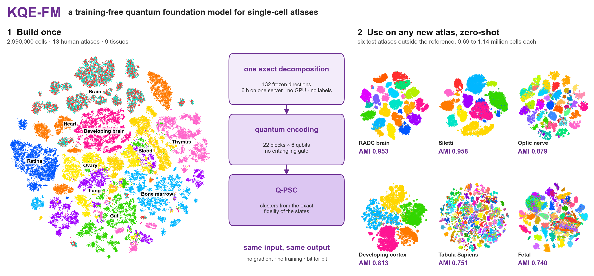
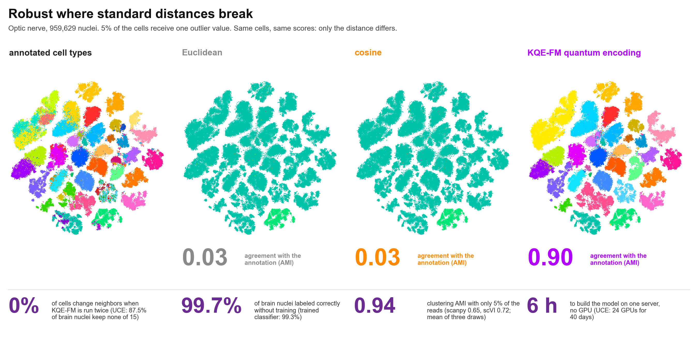

# KQE-FM: a quantum foundation model for single-cell atlases

KQE-FM is computed, not trained. It is fitted once by an exact decomposition of a public reference of single-cell atlases,
stored as one file, and applied unchanged to any new atlas. Every cell of the new atlas is projected onto the frozen
directions, encoded into a product state of qubits without entangling gates, and clustered by the exact fidelity of the
states. No step uses a gradient, a label or a random number, so the same input always returns the same output.





## Install

```bash
pip install git+https://github.com/hank08819/scKQE-2.git   # quantum encoding and Q-PSC
pip install .                                               # this package
pip install torch                                           # nearest-state search (a GPU is used when present)
```

## Quick start

```python
from kqefm import KQEFM, cluster, transfer_share

# 1. Build once (replaces training): cells drawn from each reference atlas with a fixed seed
model = KQEFM.build_from_h5ad(["ref_atlas_1.h5ad", "ref_atlas_2.h5ad"], cells_per_atlas=230000)
model.save("kqefm_model.npz")

# 2. Use on a new atlas (zero-shot): same genes, reference weights, frozen directions
model = KQEFM.load("kqefm_model.npz")
E = model.project_h5ad("new_atlas.h5ad")          # cells x 132 whitened scores

# 3. Cluster in quantum-state space
labels = cluster(E, k=20)                          # Q-PSC on the certified 15-nearest-state graph
```

Command line:

```bash
kqefm build kqefm_model.npz ref_atlas_1.h5ad ref_atlas_2.h5ad
kqefm project kqefm_model.npz new_atlas.h5ad scores.npy
kqefm cluster scores.npy 20 labels.npy
```

## What each step computes

| Step | Computation |
|---|---|
| Gene space | genes mapped to one universe of Ensembl identifiers; symbol-indexed atlases are mapped through the reference symbol table |
| Preprocessing | `log(1 + count)`, inverse document frequency weights from the reference, unit length per cell |
| Model | 132 leading right singular vectors of the centered reference (ARPACK, start vector of ones), the mean and the singular values |
| Projection | `e_j = sqrt(n) (z - mu)^T v_j / s_j`, unit variance over the reference cells |
| Encoding | each score turns one qubit; 22 blocks of 6 qubits, three layers of `R_Y` and `R_Z`, `s = 0.19`, no entangling gate |
| Comparison | fidelity of two cells `F = prod_q (1 + r_q . r'_q) / 2` from their Bloch vectors, in closed form |
| Clustering | Q-PSC: certified exact 15 nearest states, fidelity-weighted graph, Leiden to `round(1.5 k)` clusters, merged to `k` |

## Checking a new atlas against the reference

```python
H_counts, gene_ids = ...                           # count matrix and Ensembl IDs of the new atlas
share = transfer_share(model, H_counts, gene_ids)  # labels are optional
print(share["share_total"])
```

`share_total` is the variance of the new atlas captured by the frozen directions, relative to its own leading directions,
computed without labels. With annotations, `share_between` gives the same ratio for the variance between annotated groups.
A tissue that is far from the reference can be added to the reference by rebuilding the model.

## Reproducibility

The reference sample uses a fixed seed, the decomposition starts from a fixed vector, the projection, the Bloch vectors and
the fidelities have closed forms, the nearest states are certified exact, and Leiden runs with a fixed seed. Rerunning any
step on the same input returns identical scores, neighbors and clusters.

## Citation

Han, H. KQE-FM: a training-free quantum foundation model for reproducible single-cell discovery (2026).
Han, H. Reproducible quantum clustering for single-cell transcriptome atlases (2026).

## License

MIT
